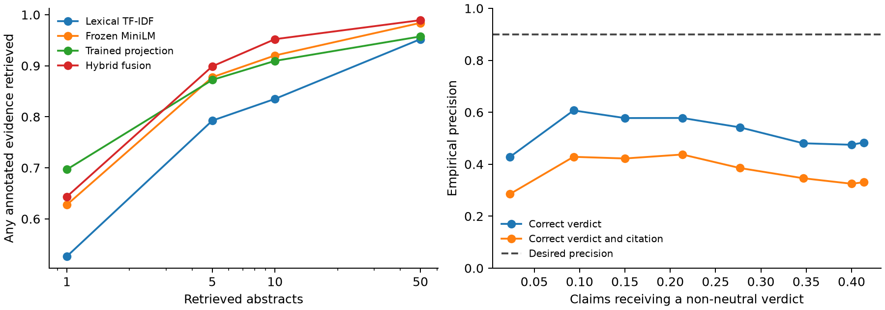

# Evidence Retrieval Bench

[](https://github.com/aarnavbhat23/evidence-retrieval-bench/actions/workflows/retrieval.yml)

Finding a relevant abstract is easier than correctly verifying a scientific claim.

This repository builds a **5,183-abstract** index from SciFact, trains a contrastive projection on frozen MiniLM embeddings, compares four retrieval methods, and evaluates an NLI verifier on **all 300 official development claims**. It measures correct citations alongside correct verdicts, so a persuasive but unsupported answer cannot count as a success.



## Measured results

Retrieval is evaluated on the **188 development claims with annotated evidence**. The 112 claims without evidence remain in verification evaluation.

| Retrieval method | Any evidence at rank 1 | Any evidence in top 5 |
|---|---:|---:|
| Lexical TF-IDF | 52.7% | 79.3% |
| Frozen MiniLM | 62.8% | 87.8% |
| Trained 128-dimensional projection | 69.7% | 87.2% |
| Lexical + trained projection fusion | 64.4% | 89.9% |

The frozen transformer is not fine-tuned. A shared linear projection is trained on 415 annotated claim/document pairs, with 90 held out by target-document group for checkpoint selection. It improves rank-1 recall, but not rank-5 recall relative to the frozen encoder. The hybrid uses fixed reciprocal-rank fusion, not a development-tuned weighting.

The verifier's development accuracy is **46.7%**, with macro F1 **0.440**. At confidence 0.9, it issues non-neutral verdicts on 15.0% of claims: 57.8% have the correct verdict, but only **42.2% have both the correct verdict and an annotated evidence citation**. No validation threshold with at least ten accepted examples met the desired 90% combined precision. The selected policy therefore abstains on every development claim. This release is a failure benchmark and search tool, not an accurate scientific answer system.

## Try it and reproduce

```bash
python -m venv .venv
source .venv/bin/activate
python -m pip install -r requirements.txt
python -m unittest discover -s tests -v
python replay.py
# Reconstruct the free corpus and embeddings:
python fetch.py
python corpus.py --device cpu
python experiment.py --device cpu
python plot.py
# Search the corpus with the trained hybrid:
python search.py 'Interferon changes immune cell gene expression.'
```

`search.py` returns document IDs, exact sentence indexes and candidate passages. It does not fabricate a generated answer or declare retrieved text to be verified evidence. The output texts retain S2ORC attribution. The recorded encoding and NLI evaluation used Apple M3/MPS, while projection training used CPU. Pretrained weights download free from Hugging Face; no model API is used. Source abstracts and pretrained encoder weights are not bundled into this repository.

## Pipeline

- Fit TF-IDF on the public corpus only. Dense encoding uses `sentence-transformers/all-MiniLM-L6-v2`, revision `1110a243fdf4706b3f48f1d95db1a4f5529b4d41`, normalized mean pooling and a stated 256-token truncation limit. Title and abstract are concatenated; the manifest counts truncated texts.
- Train a symmetric query/document projection with in-batch contrastive loss. Repeated copies of the same positive document are treated as positives, not false negatives. Where a claim has multiple annotated documents, the first numeric document ID is the training target; retrieval evaluation accepts any annotated document. Other unselected true positives can still enter a batch as negatives, a known limitation of this training objective.
- Select projection epoch 25 by validation-document-group corpus cross entropy. All 5,183 abstracts are available to the retrieval index, including development evidence documents; this is a closed-corpus setting, not a new-paper transfer benchmark.
- Fuse lexical and trained-dense top-50 rankings with reciprocal rank constant 60. For the top three abstracts, select two sentences lexically without looking at gold rationales. Run pinned `cross-encoder/nli-MiniLM2-L6-H768`, revision `b95119ce93d3e065de6214e38cd4a97b0f2f2c6d`. The abstract passage is the premise and claim is the hypothesis. Select the passage with greatest non-neutral probability and use its three-class prediction.
- Evaluate all official development labels. Record verdict, score, selected citation and sentence indexes. Measure both label precision and label-plus-citation precision for the fixed confidence grid. Select an empirical abstention threshold on the 90 validation claims, never on development labels. Those validation claims also selected the projection checkpoint, so the policy is not backed by an independent calibration guarantee.

## An overlap diagnostic

Of the 188 evidence-bearing development claims, 87 have an evidence document used in projection training; 101 do not. Hybrid top-5 recall is 93.1% and 87.1% respectively. Official train/development text contains **two exact claim matches**, and 13 development claims have nearest-training TF-IDF cosine at least 0.9. The primary experiment retains the official split and openly reports these diagnostics. A duplicate-free evaluation and an independent new-paper corpus remain outstanding. Generic encoder pretraining may also include scientific texts; we make no contamination-free claim.

## Checkable artifacts

`results/retrieval-ledger.jsonl` exposes all four top-50 rankings and annotated document IDs. `verification.jsonl` retains all 300 verdicts, probabilities, document IDs and sentence selections. `calibration-verification.jsonl` records the threshold-selection cases. `projection-split-ledger.csv` and `train-dev-text-similarity.csv` identify training boundaries and text overlap. `results/projection.pt`, `history.json`, the two model manifests and `metrics.json` preserve the trained head and source/model pins. `replay.py` recomputes retrieval recall, verdict metrics and every precision/coverage point without downloading transformer weights.

## Prior work, scope and attribution

Scientific claim verification is an established task. Credit [SciFact / Wadden et al., 2020](https://github.com/allenai/scifact), [MultiVerS](https://github.com/dwadden/multivers), the [MiniLM sentence encoder](https://huggingface.co/sentence-transformers/all-MiniLM-L6-v2), and the [NLI model](https://huggingface.co/cross-encoder/nli-MiniLM2-L6-H768). This repository adds original pipeline code and a reproducible retrieval-versus-verification audit; it does not introduce a new benchmark dataset or claim state-of-the-art verification.

SciFact claims and annotations retain [CC BY 4.0](https://creativecommons.org/licenses/by/4.0/); corpus abstracts retain [ODC-By 1.0](https://opendatacommons.org/licenses/by/1-0/). See [upstream license](https://github.com/allenai/scifact/blob/master/LICENSE.md). Pretrained models retain Apache 2.0; our code is MIT. Both source and model revisions are pinned. Built with AI assistance, with numbers from completed runs. There is no independent review or adoption claim.

The next useful experiment is a biomedical verifier trained on a document-disjoint split, with all-positive contrastive batches, a held-out threshold calibration partition and exact rationale evaluation. Improving verification is more valuable than attaching an LLM that writes fluent answers over the same weak evidence.
